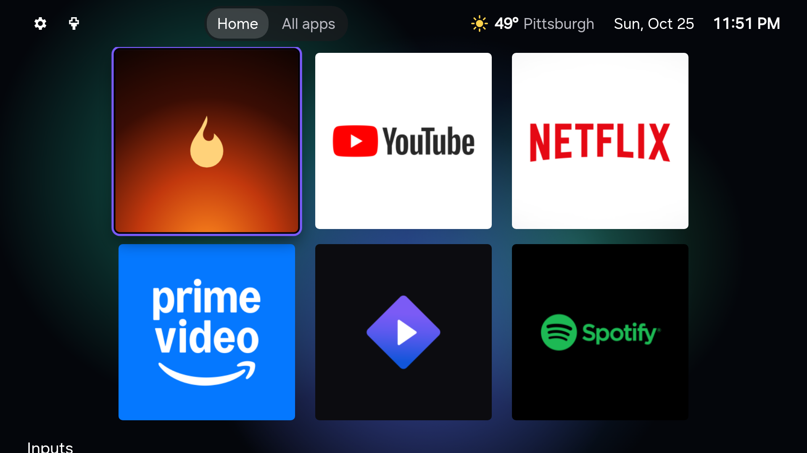
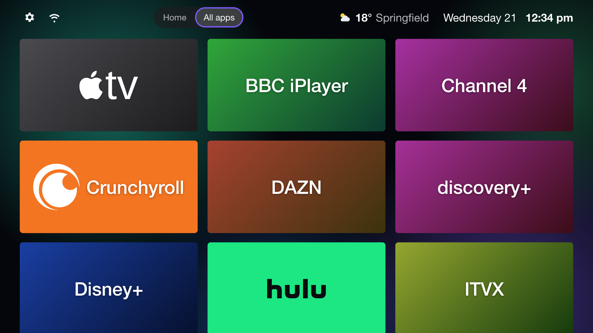
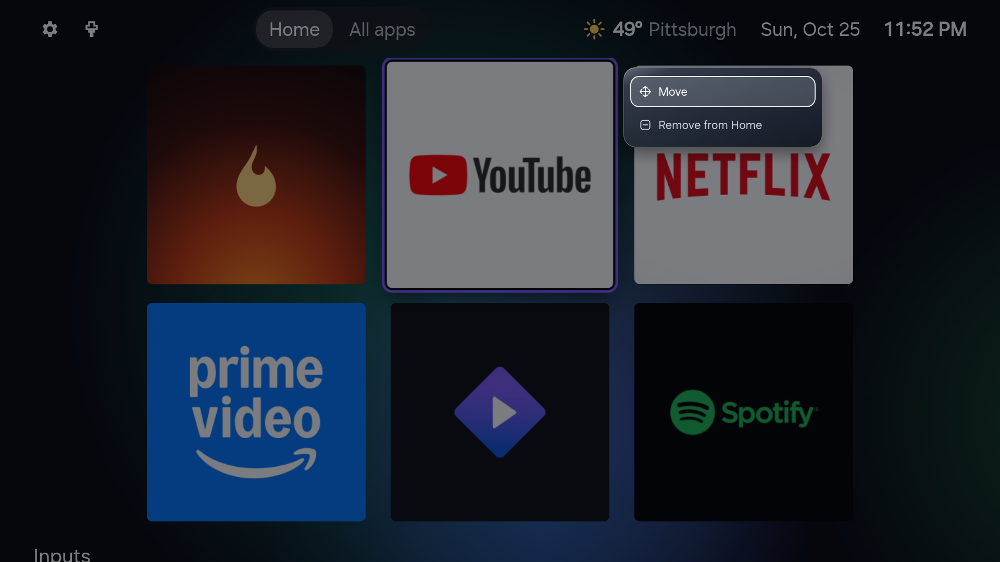
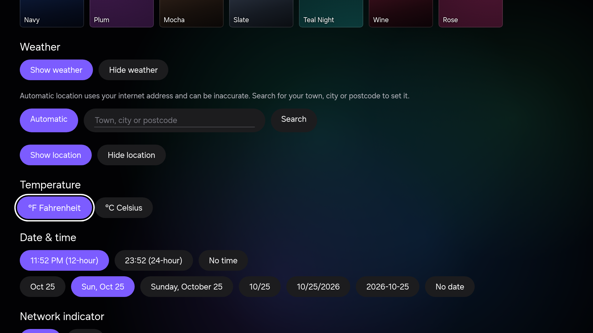

# AeroTizen

[](https://github.com/helalaou/AeroTizen/actions/workflows/ci.yml)
[](LICENSE)
[](https://github.com/helalaou/AeroTizen/graphs/contributors)
[](CONTRIBUTING.md)

A simple home screen for Samsung TVs, and a command-line tool to clean the TV up from your computer.

Built with help from these contributors. [Join them](CONTRIBUTING.md): testing on your TV counts too.

<!-- contributors:start -->
<table>
  <tr>
    <td align="center"><a href="https://github.com/helalaou"><br><sub>helalaou</sub></a></td>
    <td align="center"><a href="https://github.com/metacurb"><br><sub>metacurb</sub></a></td>
    <td align="center"><a href="https://github.com/oflarcade"><br><sub>oflarcade</sub></a></td>
    <td align="center"><a href="https://github.com/motorgrid-ita"><br><sub>motorgrid-ita</sub></a></td>
    <td align="center"><a href="https://github.com/cvvspb"><br><sub>cvvspb</sub></a></td>
    <td align="center"><a href="https://github.com/tjmcleod8"><br><sub>tjmcleod8</sub></a></td>
  </tr>
</table>
<!-- contributors:end -->



## Motivation

The default home screen on recent Samsung TVs is mostly ads. The "Top Picks for You" row can't be
removed, Samsung TV Plus starts playing on its own at boot, and the TV tracks what you watch unless
you find the privacy settings to turn it off.

On Android TV you would install a different launcher and remove the junk over ADB. Tizen makes
this harder: developer access is limited, and the official developer tools are a large SDK that
doesn't run natively on Apple Silicon.

AeroTizen works around that. The launcher is a normal TV app that acts as the home screen: it opens
when the TV turns on and comes back when you press Home. The CLI handles the setup (certificates,
signing, installing) and shows which preinstalled apps can be removed. Tizen Studio and root
access aren't needed.

## Features

On the TV:

- Your apps as square cards using each app's own artwork from the TV. Pick **Big** (3 across) or
  **Small** (5 across). Apps without artwork show their icon and name
- **Home** and **All apps** tabs: keep favourites on Home and open any installed app from All apps
- Opens at power-on and comes back when you press Home (see [Home options](#choose-how-home-works)
  and [Limits](#limits))
- Hold OK on a tile for **Move**, **Add to Home** or **Remove from Home**
- Opens HbbTV apps such as BBC iPlayer
- Inputs list every HDMI port and the name of what's plugged in. You can rename them, and hide
  disconnected ports or the Live TV tile
- 31 backgrounds, 16 of them animated, with a speed slider and preview (for example [Snowfall](docs/screenshots/theme-snowfall.png) and [Lava](docs/screenshots/theme-lava.png))
- Optional [dynamic weather wallpapers](docs/dynamic-weather-wallpapers.md): nine local AI-generated scenes follow weather, day/night and sunset. Off by default; [provenance and redistribution](launcher/assets/weather/CREDITS.md) are documented.
- Time, date and weather in the top bar. Date and time follow the TV's language and 12/24-hour
  setting, and °C or °F is picked from your region. You can change their formats or visibility
  in Settings
- Weather for a town you search for, or an approximate location from your internet address. The
  place name can be hidden
- Shows whether the TV is on Ethernet or Wi-Fi. Show or hide it in **Settings → Network indicator**
- An optional Fireplace tile that plays a fireplace video
- Works on The Frame: AeroTizen leaves Art Mode alone
- Settings to choose which apps show up, open the Samsung app store, or go back to Samsung's home screen

From your computer (`aerotizen`):

- Finds the TV on your network
- Connects to the TV's developer port directly in Python, on macOS, Linux or Windows
- Creates the Samsung signing certificates for your TV (you sign in to your Samsung account once)
- Signs and installs any `.wgt` app, including the launcher
- Opens apps and checks that they actually came up on screen (`aerotizen launch`)
- Restarts apps with Chrome DevTools for debugging (`aerotizen inspect launcher`)
- Checks, backs up, applies and restores native Home settings from the PC, with no root
  needed for normal setup ([Home options](#choose-how-home-works))
- Lists installed apps, flags the bloat, and removes it if your firmware allows

There's also a short [guide to the settings worth turning off](docs/settings.md) (ads, viewing
data, autorun) and [DNS blocklists](dns/) if you run Pi-hole, AdGuard Home or NextDNS.

| All apps | Hold OK on a tile |
|---|---|
|  |  |

| Settings | More settings |
|---|---|
|  |  |

## Tested on

| TV | Year | Firmware | Notes |
|---|---|---|---|
| Samsung 55" Crystal UHD U8000F (UE55U8000FKXXU) | 2026 | Tizen 9.0 | |
| Samsung 75" QLED Q7F (QE75Q7FAAUXXH) | 2025 | Tizen 9.0 | |
| Samsung 55" Crystal UHD U8092F (UE55U8092FUXXH) | 2025 | Tizen 9.0 | Native Home apply fails ([#69](../../issues/69)) |
| Samsung 65" Crystal UHD DU7200 (UN65DU7200FXZA) | 2024 | Tizen 9.0 | |
| Samsung 65" The Frame LS03D (QE65LS03DAUXXU) | 2024 | Tizen 9.0 | |
| Samsung 70" Crystal UHD CU7000 (UN70CU7000DXZA) | 2023 | Tizen 9.0 | |
| Samsung 65" Crystal UHD CU7000 (UN65CU7000DXZA) | 2023 | Tizen 9.0 | Native Home works; Add apps fix in [#81](../../pull/81) |
| Samsung 65" Crystal UHD CU7172 (UE65CU7172UXXH) | 2023 | Tizen 9.0 | Native Home works |
| Samsung 65" OLED S90C (QE65S90CATXZT) | 2023 | Tizen 7.0 / 9.0 | |
| Samsung 75" QLED Q60B (QE75Q60BAUXXC) | 2022 | Tizen 6.5 | |
| Samsung 55" OLED S95B (QE55S95BATXXC) | 2022 | Tizen 6.5 | Cold boot issue ([#47](../../issues/47)) |
| Samsung 55" QLED Q80B (QE55Q80BATXXC) | 2022 | | Watcher works; native Home apply fixed in [#79](../../pull/79) |
| Samsung 65" The Frame LS03A (QN65LS03AAFXZC) | 2021 | | Runs; Home doesn't return yet ([#65](../../issues/65)) |
| Samsung 65" Crystal UHD AU7172 (UE65AU7172UXXH) | 2021 | Tizen 6.0 | Home doesn't return yet ([#65](../../issues/65)) |
| Samsung 43" Crystal UHD AU8000 (UN43AU8000FXZC) | 2021 | | Runs; Home and power-on don't work yet ([#65](../../issues/65)) |
| Samsung 65" Crystal UHD TU7179 (GU65TU7179UXZG) | 2020 | Tizen 5.5 | Runs; native Home doesn't work yet ([#84](../../issues/84)) |
| Samsung 32" The Frame LS03T (QE32LS03TCUXZT) | 2020 | Tizen 5.5 | Runs; native Home doesn't work yet ([#75](../../issues/75)) |

Other Samsung TVs from 2020 on should work, but these are the only models tested so far. If you try it
on yours, please [open a model report](../../issues/new?template=model_report.yml).

## Setup

You need a computer on the same network as the TV.

1. Download the latest **CLI** release (`cli-v...`) from
   [Releases](https://github.com/helalaou/AeroTizen/releases). Extract the archive for your
   computer: Linux x64, Windows x64, or macOS Apple silicon / Intel. It contains
   `aerotizen`, including Python and its dependencies.

   Open a terminal in the extracted directory and check that it finds your TV.
   On macOS or Linux:

   ```bash
   ./aerotizen discover
   ```

   In Windows PowerShell:

   ```powershell
   .\aerotizen.exe discover
   ```

   Run the remaining commands from this directory. The examples below use
   `./aerotizen`; in Windows PowerShell, use `.\aerotizen.exe` instead.

2. Turn on Developer Mode on the TV. Open **Apps**, type `12345` on the remote (or with the
   on-screen number pad), switch Developer mode on, and set Host PC IP to your computer's IP.
   On some newer firmware `12345` only works from **Apps → App Settings** (at the bottom of the
   Apps tab). Check all four numbers of the IP before pressing OK: the first one doesn't always
   change. Then unplug the TV for a minute. Turning it off with the remote isn't enough for the change to
   apply. `./aerotizen status` should now show `developerMode=1`.

3. Create the certificates. This opens Samsung's sign-in page in your browser:

   ```bash
   ./aerotizen certs
   ```

4. Install the launcher:

   ```bash
   ./aerotizen install launcher
   ```

   This downloads the latest stable **launcher** release, checks its checksum and
   compatibility, signs it with your TV certificates, and installs it. No source checkout
   or Node.js is needed. Keep your existing certificates for future app updates.

   Run the same command to install a newer launcher. To select a version, use
   `./aerotizen install launcher --version 2.2.0` (replace the number with a published
   launcher version). CLI and launcher versions are independent; a launcher release
   can require a newer CLI. Use `./aerotizen --version` to check your CLI version.

   To install local development files or a downloaded package, use an explicit path:
   `./aerotizen install ./dist/launcher` (after `npm ci && npm run build`) or
   `./aerotizen install ./app.wgt`.

Optional: add the extracted directory to your `PATH` to run `aerotizen` from any
directory. You can then omit `./` (macOS/Linux) or `.\` (Windows) from the commands.

If you already use Python 3.10 or newer, you can instead install the CLI with
`pip install git+https://github.com/helalaou/AeroTizen` and run it as `aerotizen`.

The launcher is now installed and uses the watcher by default. The gear icon opens settings.
For the optional native Home setup, see [Home options](#choose-how-home-works).

In **Settings → Weather**, choose **Show weather** or **Hide weather**. Hiding weather
stops automatic location and forecast requests, while keeping your saved location and
units. In **Date & time**, choose **No time** or **No date** to hide either item; selecting
a format shows it again. **Network indicator** has its own **Show** and **Hide** controls.
All three header items are shown by default. Choices apply at once and stay saved after
a restart.

For accurate weather, open **Settings → Weather** and search for your town or postcode.

To look at or remove installed apps, run `./aerotizen apps` and `./aerotizen debloat`. To remove AeroTizen itself, run
`./aerotizen uninstall launcher`.

## Continue Watching (experimental)

In **Settings → Continue Watching**, select **On**, then choose the apps to include.
A combined row appears below your Home apps, sorted by the activity time each app supplies.
The feature is off by default. Switching it off stops feed reads and hides the row;
your app choices stay saved.

Discovery uses installed apps' Samsung Continue Watching declarations, including their
background services. It does not open the apps. An empty source stays selectable and
adds no cards. Missing app-ID mappings remain disabled. Settings uses smaller versions
of the TV app icons, with a check mark for selected apps.

Everything runs on the TV. This reader needs no root, PC connection or separate
login. YouTube and Prime Video populated automatically in a clean cold-boot test
on a 2024 Frame running Tizen 9.0. BBC iPlayer's installed version did not expose
a shared feed. Stremio support is a separate follow-up.

The row refreshes at startup, when you return to AeroTizen and when you change source
choices. Empty lists get two short retries on ordinary refreshes. During startup,
empty or unavailable feeds are checked for up to five minutes. Checks stop when data
arrives, when you leave AeroTizen or when the feature is switched off. There is no
continuous polling.
Cards show full 16:9 artwork with a TV app icon in the top-right corner. Progress and
programme details sit below the image. Unchanged cards keep their loaded artwork.
Viewing records stay in memory; only your choices are saved. Providers can return old
records or approximate activity times. Unknown times sort last. Distinct episodes stay
separate. Selecting a card sends its original launch data to the source app; correct
programme opening still needs physical confirmation for each provider.

Known limits on the tested Frame: ITVX returns five saved records while its own row
shows only S38 E12 of The Only Way Is Essex. Its background service only reads that
saved store; it does not refresh it from the current in-app list. Channel 4 returns
an empty shared list even with root, despite showing Continue Watching in its app.
Neither source is confirmed as an accurate mirror of its in-app row.

## Choose how Home works

Both options run on the TV; your computer can be switched off after setup. Neither needs root.

| Option | How it works |
|---|---|
| **Watcher (default)** | A background service detects a return to Samsung Home and reopens AeroTizen. Some apps cannot be detected (see [Limits](#limits)). |
| **Native Home (opt-in)** | The TV routes Home from other apps to AeroTizen, with optional automatic startup. The watcher is disabled. |

Native Home is experimental. Other models and firmware can now test if compatibility checks
pass: a 32-bit ARM Tizen runtime, developer access, required native functions and complete
settings reads. Apply also checks the installed launcher's eligibility and control service.
Physical tests cover a 2024 Frame and a contributor's S90C, both on Tizen 9. The S90C passed
Home-only, automatic startup, Home from YouTube/Prime and restore with the app installed.
Passing preflight does not prove behaviour on another TV. See the
[S90C report](docs/home-s90c-tv-20261027.json).

If the Home helper cannot start, use the [read-only runtime probe](docs/home-runtime-probe.md)
to collect a limited file inventory without .NET on the TV. It does not enable Native Home.

Use matching updated builds of the CLI and signed launcher. Save the original Home
backup before opening AeroTizen (replace `TV_IP` with your TV's address):

```sh
./aerotizen --tv TV_IP home status
./aerotizen --tv TV_IP home backup
```

Then open AeroTizen on the TV to start its control service, and apply Home only:

```sh
./aerotizen --tv TV_IP home apply --yes
```

If you already have a valid original backup, keep it. Some TVs change
`booting_appid_backup` to `DclHome001.Home` when AeroTizen opens. Apply permits
only this difference; all other values must match. It restores the saved startup
values before completing Home-only apply. A new backup still needs original
values and will refuse an AeroTizen assignment. See [backup guidance](docs/home-read-only.md#backup-behavior).

Restart fully, then test Home from YouTube, Prime Video and Samsung Home. Run restore and
check that Samsung Home returns. To test automatic startup separately, restore first, then
run `./aerotizen --tv TV_IP home apply --boot --yes`. Restore before changing options.
If compatibility checks fail, the command stops before changing settings or pausing the watcher.
Native function availability does not prove write permission; failed writes attempt rollback.
Keep the backup folder and inspect `home status` if a change fails. Status reports service
query errors; a timeout does not mean the launcher was uninstalled.
See the [controlled TV tests](docs/home-profile-isolation-tv-20261026.json).

The TV's original Home and startup values are saved once on the PC in
`~/.config/aerotizen/backups/<TV identity>/`. Later backups preserve that original.
Keep the **whole folder**, including its recovery records; you can copy it to another
authorised PC. This is a backup of the settings changed by this feature, not the whole TV.

To revert, whether AeroTizen is still installed or has been uninstalled, run:

```sh
./aerotizen --tv TV_IP home restore --yes
```

Restore uses your saved values, not hardcoded Samsung defaults. If AeroTizen is installed,
it coordinates with the control service and re-enables the watcher. After uninstall, the
CLI restores directly through the developer connection; no reinstall or root is needed.
**After apply or restore, disconnect TV/One Connect power for 60 seconds, then restart.**
Before `uninstall launcher`, restore native Home; uninstall stops while Home or startup still points to AeroTizen.
Samsung Home remains available from AeroTizen Settings; Samsung's Art Mode sleep and
Night Mode settings stay unchanged. See [setup and recovery](docs/home-pc-flow.md) for
backup transfer and recovery steps. Test reports should include the CLI commit, TV model,
firmware, and Home/restore/boot results; remove device IDs and private paths before sharing.

## Limits

Samsung doesn't support any of this officially, so some parts are workarounds:

- At power-on, Samsung's **Autorun Samsung TV Plus** and **Autorun Last App** settings can open
  something before AeroTizen does. Turn them off (see the [settings guide](docs/settings.md)).
- **Watcher:** Pressing Home brings AeroTizen back after a second or two. That works from Samsung's home
  screen and inside Netflix, but not inside YouTube, Prime Video, Stremio, Spotify or HbbTV apps. Those apps
  don't report whether they're on screen, so there's no way to tell. Back still works everywhere.
  After Home in one of them, AeroTizen comes back once that app closes or you open an app that does
  report itself, such as Netflix. You can also open AeroTizen from Samsung's app row.
- **Live TV and YouTube** open in Samsung's own player, so the remote works normally there. The
  watcher pauses while they're open, so with the watcher, Home from Live TV or YouTube leaves you on
  Samsung Home; use Back, or open AeroTizen from the app row. Native Home returns from both.
- **Watcher on The Frame:** AeroTizen checks Art Mode before every return and stays out of the way while it's
  on. If the TV doesn't report its power or Art Mode state, AeroTizen waits rather than guess.
  Tested on a 2024 Frame (QE65LS03DAUXXU, Tizen 9.0); starting from a cold boot isn't verified yet.
- **Native Home (experimental):** Home with boot enabled passed YouTube, Prime Video and Samsung Home
  return on the recorded Frame with Samsung's original Art target. Samsung Home checks allowed a
  10-second wait.
  Startup still shows a black screen for about 30 seconds. Home from Art Mode opens Samsung's Art
  page; a second Home press opens AeroTizen.
  Restore after uninstall has local test coverage; its TV test is pending.
- On Tizen 6 and newer, store and preinstalled apps can't be removed over the developer
  connection. You can delete them on the TV under Apps → Settings. Samsung's system apps (TV Plus,
  Gaming Hub) can only be disabled.
- TV apps are drawn at 1920×1080 and upscaled, even on a 4K panel. Only video plays at full 4K.
- Samsung's own menus and screens can't be changed. The [settings guide](docs/settings.md) and
  [DNS lists](dns/) cover what you can switch off.

## Contributing

The goal is a home screen that works well on every Samsung TV and gets as far as possible from the
ads and clutter Tizen ships with. Help is welcome, especially testing on other models: a model
report saying what works and what doesn't is the most useful contribution. Pull requests for
fixes, new themes or features are welcome too. See [CONTRIBUTING.md](CONTRIBUTING.md).

## Credits

- [LTvLauncher](https://github.com/leanbitlab-org/LtvLauncher), which the layout is based on
- [Apps2Samsung](https://github.com/Apps2Samsung/Apps2Samsung) and [tizen-sdb](https://github.com/PatrickSt1991/tizen-sdb), for how the developer connection, certificates and signing work
- [samsung-tizen-tv-debloat](https://github.com/ardazeytin/samsung-tizen-tv-debloat), for which packages are safe to remove
- App artwork is read from Samsung's cache on each TV; none is bundled or downloaded. Fallback logos
  are from [Simple Icons](https://simpleicons.org). Artwork and trademarks belong to their owners
- Weather and location search from [Open-Meteo](https://open-meteo.com), automatic location from [ipapi](https://ipapi.co)

This project isn't affiliated with Samsung. Use it at your own risk.

## License

[MIT](LICENSE)
