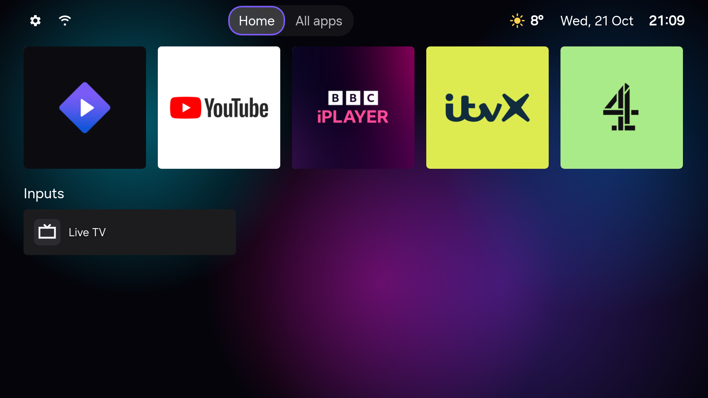
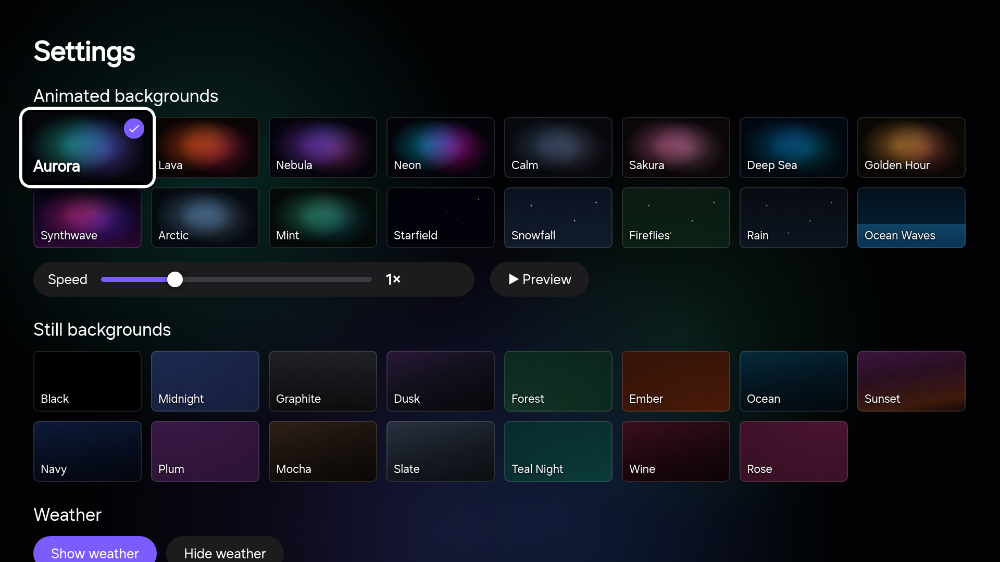

# AeroTizen

[](https://github.com/helalaou/AeroTizen/actions/workflows/ci.yml)
[](LICENSE)
[](https://github.com/helalaou/AeroTizen/graphs/contributors)
[](CONTRIBUTING.md)

A simple home screen for Samsung TVs, and a command-line tool to clean the TV up from your computer.

Built with help from these contributors. [Join them](CONTRIBUTING.md): testing on your TV counts too.

<a href="https://github.com/helalaou/AeroTizen/graphs/contributors">
  
</a>



## Motivation

The default home screen on recent Samsung TVs is mostly ads. The "Top Picks for You" row can't be
removed, Samsung TV Plus starts playing on its own at boot, and the TV tracks what you watch unless
you find the privacy settings to turn it off.

On Android TV you would install a different launcher and remove the junk over ADB. Tizen allows
neither: there's no way to replace the home screen, no shell, and the official developer tools are
a large SDK that doesn't run natively on Apple Silicon.

AeroTizen works around that. The launcher is a normal TV app that acts as the home screen: it opens
when the TV turns on and comes back when you press Home. The CLI handles the setup (certificates,
signing, installing) and shows which preinstalled apps can be removed. Tizen Studio and root
access aren't needed.

## Features

On the TV:

- Your apps as square cards using each app's own artwork from the TV. Pick **Big** (3 across) or
  **Small** (5 across). Apps without artwork show their icon and name
- **Home** and **All apps** tabs: keep favourites on Home and open any installed app from All apps
- Opens at power-on and comes back when you press Home (see [Limits](#limits))
- Hold OK on a tile to move it around
- Opens HbbTV apps such as BBC iPlayer
- Inputs list every HDMI port and the name of what's plugged in. You can rename them, and hide
  disconnected ports or the Live TV tile
- 31 backgrounds, 16 of them animated, with a speed slider and preview (for example [Snowfall](docs/screenshots/theme-snowfall.png) and [Lava](docs/screenshots/theme-lava.png))
- Time, date and weather in the top bar. Date and time follow the TV's language and 12/24-hour
  setting, and °C or °F is picked from your region. You can change their formats or visibility
  in Settings
- Weather for a town you search for, or an approximate location from your internet address. The
  place name can be hidden
- Shows whether the TV is on Ethernet or Wi-Fi. Show or hide it in **Settings → Network indicator**
- An optional Fireplace tile that plays a fireplace video
- Works on The Frame: AeroTizen leaves Art Mode alone
- Settings to choose which apps show up, open the Samsung app store, or go back to Samsung's home screen

From your computer (`aerotizen`):

- Finds the TV on your network
- Connects to the TV's developer port directly in Python, on macOS, Linux or Windows
- Creates the Samsung signing certificates for your TV (you sign in to your Samsung account once)
- Signs and installs any `.wgt` app, including the launcher
- Opens apps and checks that they actually came up on screen (`aerotizen launch`)
- Lists installed apps, flags the bloat, and removes it if your firmware allows

There's also a short [guide to the settings worth turning off](docs/settings.md) (ads, viewing
data, autorun) and [DNS blocklists](dns/) if you run Pi-hole, AdGuard Home or NextDNS.

| Settings | Moving a tile |
|---|---|
|  |  |

The device names and weather in these screenshots are placeholders.

## Tested on

| TV | Year | Firmware |
|---|---|---|
| Samsung 65" Crystal UHD DU7200 (UN65DU7200FXZA) | 2024 | Tizen 9.0 |
| Samsung 65" The Frame LS03D (QE65LS03DAUXXU) | 2024 | Tizen 9.0 |
| Samsung 65" OLED S90C (QE65S90CATXZT) | 2023 | Tizen 7.0 |
| Samsung 75" QLED Q60B (QE75Q60BAUXXC) | 2022 | Tizen 6.5 |

Other Samsung TVs from 2020 on should work, but these are the only models tested so far. If you try it
on yours, please [open a model report](../../issues/new?template=model_report.yml).

## Setup

You need a computer on the same network as the TV, with Python 3.10 or newer.

1. Install the CLI and check that it finds your TV:

   ```bash
   pip install git+https://github.com/helalaou/AeroTizen
   aerotizen discover
   ```

2. Turn on Developer Mode on the TV. Open **Apps**, type `12345` on the remote (or with the
   on-screen number pad), switch Developer mode on, and set Host PC IP to your computer's IP.
   Then unplug the TV for a minute. Turning it off with the remote isn't enough for the change to
   apply. `aerotizen status` should now show `developerMode=1`.

3. Create the certificates. This opens Samsung's sign-in page in your browser:

   ```bash
   aerotizen certs
   ```

4. Install the launcher:

   ```bash
   git clone https://github.com/helalaou/AeroTizen && cd AeroTizen
   aerotizen install launcher
   ```

That's it. The TV will start on AeroTizen from now on, and the gear icon opens settings.

In **Settings → Weather**, choose **Show weather** or **Hide weather**. Hiding weather
stops automatic location and forecast requests, while keeping your saved location and
units. In **Date & time**, choose **No time** or **No date** to hide either item; selecting
a format shows it again. **Network indicator** has its own **Show** and **Hide** controls.
All three header items are shown by default. Choices apply at once and stay saved after
a restart.

For accurate weather, open **Settings → Weather** and search for your town or postcode.

To look at or remove installed apps, run `aerotizen apps` and `aerotizen debloat`.

## Limits

Samsung doesn't support any of this officially, so some parts are workarounds:

- Pressing Home brings AeroTizen back after a second or two. That works from Samsung's home
  screen and inside Netflix, but not inside YouTube, Prime Video, Stremio, Spotify or HbbTV apps. Those apps
  don't report whether they're on screen, so there's no way to tell. Back still works everywhere.
  After Home in one of them, AeroTizen comes back once that app closes or you open an app that does
  report itself, such as Netflix. You can also open AeroTizen from Samsung's app row.
- On The Frame, AeroTizen checks Art Mode before every return and stays out of the way while it's
  on. If the TV doesn't report its power or Art Mode state, AeroTizen waits rather than guess.
  Tested on a 2024 Frame (QE65LS03DAUXXU, Tizen 9.0); starting from a cold boot isn't verified yet.
- On Tizen 6 and newer, store and preinstalled apps can't be removed over the developer
  connection. You can delete them on the TV under Apps → Settings. Samsung's system apps (TV Plus,
  Gaming Hub) can only be disabled.
- TV apps are drawn at 1920×1080 and upscaled, even on a 4K panel. Only video plays at full 4K.
- Samsung's own menus and screens can't be changed. The [settings guide](docs/settings.md) and
  [DNS lists](dns/) cover what you can switch off.

## Contributing

The goal is a home screen that works well on every Samsung TV and gets as far as possible from the
ads and clutter Tizen ships with. Help is welcome, especially testing on other models: a model
report saying what works and what doesn't is the most useful contribution. Pull requests for
fixes, new themes or features are welcome too. See [CONTRIBUTING.md](CONTRIBUTING.md).

## Credits

- [LTvLauncher](https://github.com/leanbitlab-org/LtvLauncher), which the layout is based on
- [Apps2Samsung](https://github.com/Apps2Samsung/Apps2Samsung) and [tizen-sdb](https://github.com/PatrickSt1991/tizen-sdb), for how the developer connection, certificates and signing work
- [samsung-tizen-tv-debloat](https://github.com/ardazeytin/samsung-tizen-tv-debloat), for which packages are safe to remove
- App artwork is read from Samsung's cache on each TV; none is bundled or downloaded. Fallback logos
  are from [Simple Icons](https://simpleicons.org). Artwork and trademarks belong to their owners
- Weather and location search from [Open-Meteo](https://open-meteo.com), automatic location from [ipapi](https://ipapi.co)

This project isn't affiliated with Samsung. Use it at your own risk.

## License

[MIT](LICENSE)
