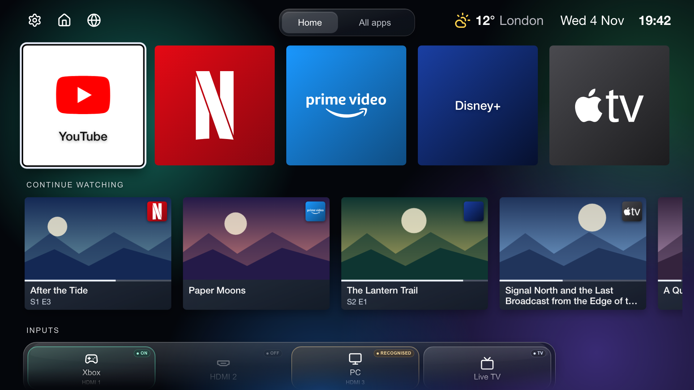

# AeroTizen

[](https://github.com/helalaou/AeroTizen/actions/workflows/ci.yml)
[](LICENSE)

AeroTizen is a home screen for Samsung TVs. It puts your favourite apps and HDMI
inputs in one place. The `aerotizen` command-line tool installs it from your computer.



*Browser preview with sample apps and programmes.*

## Quick Start

This guide uses CLI 3.0.0 and launcher 2.7.0. You need a Samsung account and a
computer on the same network as the TV. The CLI includes its dependencies.
Developer Mode is sufficient for setup.

1. **Download the CLI.** Open [GitHub Releases](https://github.com/helalaou/AeroTizen/releases).
   Select the latest stable release whose tag starts with `cli-v`. Extract the archive
   for macOS (Apple silicon or Intel), Windows x64, or Linux x64. Open a terminal in
   the extracted folder.

2. **Find your TV.** Turn it on and run `./aerotizen discover` on macOS or Linux, or
   `.\aerotizen.exe discover` in PowerShell. Note the TV's IP address. If discovery
   finds nothing, look up the IP address in the TV's network settings.

3. **Enable Developer Mode.** On the TV, open **Apps** and enter `12345` with the
   remote or on-screen number pad. On some TVs, enter it in **Apps → App Settings**
   instead. Turn on Developer Mode. Set **Host PC IP** to your
   [computer's local IP address](docs/diagnostics.md#developer-connection) and check all
   four numbers. Disconnect power from the TV or One Connect box for 60 seconds.
   Then reconnect power and turn the TV on.

4. **Check the connection, sign in, and install.** Replace `TV_IP` below with the
   **TV's** IP address. Run the commands in order. Check that `status` shows
   `developerMode=1` and an `sdb banner` before you continue. Complete the Samsung
   sign-in in your browser when `certs` opens it. Keep the certificates for updates.

   macOS or Linux

   ```sh
   ./aerotizen --tv TV_IP status
   ./aerotizen --tv TV_IP certs
   ./aerotizen --tv TV_IP install launcher
   ```

   Windows PowerShell

   ```powershell
   .\aerotizen.exe --tv TV_IP status
   .\aerotizen.exe --tv TV_IP certs
   .\aerotizen.exe --tv TV_IP install launcher
   ```

   The CLI downloads, verifies, signs, and installs the latest stable launcher.

5. **Open AeroTizen from Apps on your TV.** To use Native Home, start with the
   [backup step below](#set-up-native-home) before you open AeroTizen. The gear
   icon opens Settings.

To test before publication, [install a local build from `main`](docs/manage-installation.md#test-a-local-build).

## Choose how Home works

- **Native Home** is preferred on compatible TVs. The TV sends Home presses directly
  to AeroTizen. Setup also tries to open AeroTizen at power-on. Native Home is experimental
  and requires the steps below.
- **The watcher** is active by default. Use it if your TV does not support Native Home.
  It reopens AeroTizen when it detects a return to Samsung Home. Some apps, including
  YouTube and Prime Video, can leave you on Samsung Home. Use **Back** or open AeroTizen
  from the Samsung app row.

Both options run on the TV after setup and work without root.

### Set up Native Home

Check the [TV reports](docs/tv-compatibility.md). Replace `TV_IP` with your TV's
address. In PowerShell, use `.\aerotizen.exe` in place of `./aerotizen`.

1. **Before opening AeroTizen**, run `./aerotizen --tv TV_IP home backup` to save the
   original Home and startup settings. Keep the whole backup folder. If the backup
   fails, use the watcher.
2. Open AeroTizen on the TV. Preview the change with `./aerotizen home apply`, then
   run `./aerotizen --tv TV_IP home apply --yes`. The CLI reports whether it set up
   Home and automatic startup.
3. Disconnect power from the TV or One Connect box for 60 seconds. Reconnect power,
   check which app opens, then test the Home button from an app.

See the [Home guide](docs/home-pc-flow.md) for compatibility checks, watcher limits,
and how to restore the original settings before uninstalling AeroTizen.

## Guides

- [TV compatibility and limits](docs/tv-compatibility.md)
- [Use the launcher and Continue Watching](docs/launcher.md)
- [Update or remove AeroTizen](docs/manage-installation.md)
- [Set up with an AI assistant](docs/ai-setup.md)
- [Troubleshoot and export logs](docs/diagnostics.md)
- [Reduce ads and tracking in Samsung settings](docs/settings.md) and [DNS blocklists](dns/)
- [Optional root setup and recovery](docs/root-cli.md)

## Contributing

[Report what works on your TV](https://github.com/helalaou/AeroTizen/issues/new?template=model_report.yml)
or see [CONTRIBUTING.md](CONTRIBUTING.md) for development and testing.

<!-- contributors:start -->
<table>
  <tr>
    <td align="center"><a href="https://github.com/helalaou"><br><sub>helalaou</sub></a></td>
    <td align="center"><a href="https://github.com/metacurb"><br><sub>metacurb</sub></a></td>
    <td align="center"><a href="https://github.com/oflarcade"><br><sub>oflarcade</sub></a></td>
    <td align="center"><a href="https://github.com/motorgrid-ita"><br><sub>motorgrid-ita</sub></a></td>
    <td align="center"><a href="https://github.com/cvvspb"><br><sub>cvvspb</sub></a></td>
    <td align="center"><a href="https://github.com/tjmcleod8"><br><sub>tjmcleod8</sub></a></td>
    <td align="center"><a href="https://github.com/jamesmcnicholas"><br><sub>jamesmcnicholas</sub></a></td>
  </tr>
  <tr>
    <td align="center"><a href="https://github.com/cheack"><br><sub>cheack</sub></a></td>
  </tr>
</table>
<!-- contributors:end -->

## Credits

- [LTvLauncher](https://github.com/leanbitlab-org/LtvLauncher), which the layout is based on
- [Apps2Samsung](https://github.com/Apps2Samsung/Apps2Samsung) and [tizen-sdb](https://github.com/PatrickSt1991/tizen-sdb), for how the developer connection, certificates and signing work
- [samsung-tizen-tv-debloat](https://github.com/ardazeytin/samsung-tizen-tv-debloat), for which packages are safe to remove
- App artwork is read from Samsung's cache on each TV; none is bundled or downloaded. Fallback logos
  are from [Simple Icons](https://simpleicons.org). Artwork and trademarks belong to their owners
- Weather and location search from [Open-Meteo](https://open-meteo.com), automatic location from [ipapi](https://ipapi.co)

This project isn't affiliated with Samsung. Use it at your own risk.

## License

[MIT](LICENSE)
