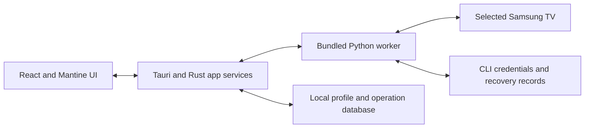

# AeroTizen desktop MVP implementation plan

Build a desktop app that lets a user select a Samsung TV, install and update AeroTizen,
set up Native Home, and restore the original Home settings without a terminal.
The first screen is for finding and selecting TVs. Each TV task has its own view after
selection. A combined setup wizard is a later feature.

The MVP targets macOS on Apple silicon and Intel, and Windows x64. It uses Tauri 2,
a React and TypeScript UI with Mantine, and the existing Python TV code as a bundled executable.
Users do not need to install Python, Node.js, Rust or the .NET SDK.

## First delivery slice

The implementation is in [desktop](../desktop/README.md). It discovers Samsung TVs, verifies
device identity before opening Overview, and saves TV profiles. The Launcher page installs,
updates or downgrades published versions with an existing signing profile from the CLI.
Creating signing profiles through Samsung sign-in remains a later stage.

The Apple Silicon macOS app discovered, connected to and saved the Samsung Frame in
the [local hardware check](../desktop/README.md#development). First-time Local Network
consent with a signed release and the Windows and Intel Mac builds still need validation.

The connected TV exposes Overview and Launcher. Overview can open a GitHub issue draft
with TV details. Home and startup, Root, Backup and recovery, and Diagnostics are planned
for later stages. The full diagnostic ZIP uses the CLI.

## Scope

| Included in the MVP | Later work |
| --- | --- |
| Search for TVs, enter an IP address and connect to saved TVs | A combined setup wizard |
| Save and rename TVs, using DUID to identify them | Cloud accounts and profile sync |
| Samsung sign in and sign out from the app menu | Linux and Windows ARM builds |
| Request Samsung sign in when certificate creation needs it | A full Rust port of the TV code |
| Install, update, open and remove the launcher | Automatic desktop app updates |
| Guided Native Home backup, apply, verification and restore | New root setup, root upgrades and root removal |
| Import existing CLI data and use an existing valid root pairing | Key mapping and debloat |
| Export recovery data and redacted diagnostic logs | General app installation and developer inspection tools |

The desktop app manages the existing TV launcher. It does not replace the launcher UI
or change the TV payloads as part of the initial implementation.

## The two main views

### TV selection

Open this view on every app start. Do not reconnect to the last TV or open a task automatically.

The main content contains only saved TVs and controls to find or connect to a TV:

- Show saved TVs with their user name, model, last known address and last connection time.
- Keep **Search for TVs** and **Enter IP address** in the network TVs section.
- When no TVs are saved, show a short empty state with the search action.
- Let users rename a saved TV or forget its entry. Forgetting an entry does not remove
  certificates, backups or anything on the TV.
- Show search, connection, not found and connection failure states in this view.

Discovery results are candidates. A name, model or IP address does not prove identity.
Read the DUID through the developer connection, or the authenticated paired connection,
before creating or matching a verified saved TV record.

A TV that needs Developer Mode can open the selected TV view in a connection setup state.
Show the correct computer address for the network route to that TV and the manual TV steps.
TV operations remain unavailable until the connection and identity are verified.

The app menu is available here. Samsung account details, install actions, Native Home
controls and a setup wizard are not part of the main selection content.

### Selected TV

Show the selected TV name and connection state, a side menu, and the active task view.
Put a connection refresh icon beside the TV name in the side menu.
Provide **Back to TVs**. Returning to TV selection does not forget the saved TV.

| Side menu item | MVP content |
| --- | --- |
| Overview | Model, Tizen and launcher versions, update link, root status, IP address and last check time |
| Launcher | Install, update, open and remove AeroTizen |
| Home and startup | Read status, check support, save the original backup, preview and apply the supported changes |
| Root | Read the status of an existing imported pairing; explain missing pairing data |
| Backup and recovery | Import and export recovery data, inspect backups and restore Home |
| Diagnostics | Inspect technical details and export redacted logs |

Add **Key mapping** when that feature is functional. Do not ship inactive menu entries
for future features. Root status must not start root setup or make a new root attempt.

Open Overview after selection. Opening a view or switching a menu item must not install,
launch, root, remap or restore anything. Native Home links to the same restore action
used by Backup and recovery; there is one implementation of that action.

Before the first explicit launcher start, offer to save the original Home settings.
The user can instead choose to continue with the watcher. Explain that later Native Home
setup still needs a valid original baseline. This is a task-specific check, not the combined
setup wizard. Do not silently start the launcher at the end of installation.

Require a successful connection and identity check to open a TV's details and actions.
If a connection refresh fails, return to the TV list and show the connection error.

## Samsung sign in and sign out

Samsung account state belongs to the app, not to one TV. TV selection, discovery and
operations that can use valid saved certificates do not require a current Samsung session.

- Provide **Sign in to Samsung** or **Sign out of Samsung** in the app menu on both main views.
- Use the system browser for sign in. Do not collect Samsung passwords in the app.
- Allow sign in before a TV is selected. Create TV certificates only after a TV is verified.
- If certificate creation needs authentication, explain why, request sign in, and return
  to the pending action after success. Recheck its selected TV before continuing.
- A cancelled or expired sign in returns to the task without a TV write or certificate replacement.
- Reuse valid existing signing profiles. An account change must not silently replace the
  author certificate used for the installed launcher.
- Derive the account display state from credentials and their validity. Do not persist a
  separate signed-in flag that can disagree with an expired or missing token.

Keep account tokens in native credential storage. Keep them out of web storage, command
arguments, UI events, diagnostics and portable TV backups. Persist only credentials
supported by the Samsung flow; do not assume that it provides token refresh.

Sign out clears the app's account credentials and cancels any pending sign-in continuation.
It does not delete TV signing certificates, remote tokens, root pairings or recovery records.
It does not end the Samsung session in the system browser. An active TV write must finish
its safe completion or recovery step even if the account session is cleared.

## Saved TV records and existing CLI data

Use a local SQLite database for desktop metadata. Keep TV credentials and recovery files
in their existing CLI-compatible formats, separate from the UI database.

| Saved field | Purpose |
| --- | --- |
| Local profile ID | Stable app reference |
| SHA-256 of the DUID | Match the TV and its existing identity-bound backup records |
| User name and model | Identify the TV in the selection view |
| Last verified IP address | Reconnect without treating the address as identity |
| Last connection and check times | Show how old a saved result is |
| Last checked launcher, Home and root status | Show cached state with its source and time |
| References to signing, pairing and backup files | Reuse private records without exposing their contents to the UI |

Use the existing CLI state directory as the default TV-data location. Pass the selected
state directory explicitly to the backend. This keeps the CLI and desktop app on the
same recovery records and session locks. Desktop profile metadata has its own app-data location.

An import can adopt a user-selected existing CLI folder. First scan and validate it without
changing files. Match its certificates, Home backups and root receipts by their identity
data, not by folder names or remembered addresses alone. Mark imported records as unverified
until a live connection confirms the DUID. Stop on conflicting records and preserve both sources.

When an address changes, discovery can suggest a candidate. Update the saved address only
after identity verification. An imported root receipt may still refer to an old address;
select the matching receipt explicitly and preserve its certificate pin and pairing checks.
The DUID identifies a record; it does not replace authentication.

Preserve the complete Home recovery folder, including transaction records. Never replace
an original baseline with the current modified values. The app can inspect a previously
modified TV, but it cannot reconstruct a missing original backup or an unrecorded history.

Provide an encrypted portable recovery export with the required signing and pairing files,
Home baseline and transactions. Validate archive paths, file references and identity data
before import. A recovery export is separate from a redacted diagnostic export. It is not
a full TV firmware image or a backup of arbitrary app-private data.

## UI library and theme

Use Mantine for the desktop app's layout, controls, forms and feedback. Use React directly
with Vite, following the [Mantine Vite guide](https://mantine.dev/guides/vite/).
The existing TV launcher keeps its Preact runtime. Give the desktop app its own package,
build configuration and styles so its React and Mantine dependencies stay out of TV builds.

| UI area | Mantine components |
| --- | --- |
| Selected TV layout and side menu | AppShell, NavLink and ScrollArea |
| Saved TVs and connection state | Card, Stack, Group and Badge |
| App menu and Samsung account actions | Menu, ActionIcon and Button |
| IP entry, TV names and task settings | TextInput, Select, Switch and the form package |
| Progress and task results | Alert, Loader, Progress and notifications |
| Confirmations and conflict details | Modal and standard buttons |

Start with `@mantine/core` and `@mantine/hooks`. Add `@mantine/form` for task forms
and `@mantine/notifications` for brief feedback. Keep operation status and recovery
instructions visible in the task view; a notification is not the only record of a failure.

Define one Mantine theme for colors, typography, spacing, focus states and control sizes.
Use CSS modules for app-specific layouts. Reuse Mantine controls before building custom
ones. Keep the TV-selection screen limited to finding and selecting TVs even though the
library supplies a full app shell. Add the side navigation only in the selected TV view.

Check keyboard navigation, focus return after dialogs, labels, contrast and narrow window
layouts. Validate the chosen Mantine and React versions in the packaged macOS and Windows
webviews during the first build stage, including overlays and scrolling.

## Application and backend structure

Keep the desktop app under a new `desktop/` directory, separate from `launcher/`.
Put the Python worker and reusable operation services under `cli/src/aerotizen/`.

- The UI owns presentation, navigation and user input. Use an injected app-service interface
  so browser tests can supply fixtures at the native service boundary.
- Rust owns profiles, account credential access, operation lifecycle and the worker process.
  Expose named Tauri commands with limited permissions, not an arbitrary shell command API.
- Python owns TV communication, certificate creation, package verification and signing,
  installation, Home changes and recovery. Extract reusable services from CLI handlers where
  needed, while keeping the CLI behavior compatible.
- Use versioned JSON messages over standard input and output. Include a request ID,
  operation, expected TV identity, progress events, result and stable error code.
  Do not parse human CLI output to decide whether an operation succeeded.
- Keep protocol output separate from redacted diagnostic output. Check the bundled worker's
  protocol and version before enabling actions.
- Ship the worker with the desktop release. The desktop app must not run CLI self-update
  against its bundled executable. Show a desktop release download link for MVP app updates.

## Operation and recovery rules

Run one TV operation at a time in the desktop app. Keep the existing shared session lock
and add a single-instance app guard. Verify the selected DUID before each operation that
writes to the TV. Keep existing root certificate pinning and Home compatibility checks.

Use explicit operation states: checking, running, waiting for user, restart required,
checking result, complete, failed and outcome unknown. Show a percentage only when the
backend can measure it. Otherwise show the current step.

Record an operation before starting a write. Retain the existing durable domain receipts
as the authority for recovery. After a lost reply, worker failure or app restart, read the
TV state and matching records before offering a retry. Do not repeat an uncertain write
automatically. Cancel only at safe boundaries and close owned processes and connections.

For Native Home:

1. Check the TV, firmware, connection and required native capabilities.
2. Save or reuse the original Home and startup baseline before the first launcher start.
   If a valid original baseline is unavailable, explain the issue and offer the watcher path.
3. Show a preview before apply. Use the existing validated apply operation.
4. Show restart instructions. Keep the state pending until live checks can verify it.
5. Ask the user to test startup and the Home button. A software check alone cannot prove
   the physical remote behavior on that model and firmware.
6. Before launcher removal, restore and verify Home when required. Preserve all recovery data.

The desktop app must retain the limits in the [Home workflow](home-pc-flow.md) and
[root pairing workflow](root-cli.md). A timeout is not proof of uninstall, root completion
or successful restoration.

## Build stages

Each stage ends with a reviewable result. Establish packaged builds early and extend the
same test and release path as features are added.

| Stage | Implementation | Completion check |
| --- | --- | --- |
| 1. App shell and packaging | Add Tauri, React, Vite, Mantine and the shared theme. Build the two main views, app menu and side navigation. Bundle a worker handshake. Establish builds for all three CPU and OS targets and the signing process. | A packaged app opens on each target and starts its bundled worker without a terminal or development tools. Mantine menus, dialogs and scrolling work in the native webview. The first screen contains only TV selection content. |
| 2. Backend contract and lifecycle | Add typed JSON requests and events, worker version checks, errors, timeouts, locks and durable operation states. | Worker failure, invalid messages and app restart give a clear recoverable state. An identity mismatch prevents writes. The existing CLI checks still pass. |
| 3. Saved TVs and connection | Add discovery, manual IP, Developer Mode guidance, profile storage, rename and forget. Add CLI-folder import and existing-pairing connection support. | A TV can be verified, saved and reconnected after app restart. A changed IP does not create a duplicate or select the wrong TV. Offline imports remain unverified. |
| 4. Account and launcher | Add menu and on-demand sign in, sign out, certificate reuse, install, update and open. Add original Home baseline capture for the first-launch check. | A fresh user can install without terminal input. An existing user can update with the original signing profile. First launch offers backup before it opens the launcher. Cancelled sign in and sign out follow the defined rules. |
| 5. Native Home and recovery | Add the full backup view, Home status, apply preview, restart guidance, result checks, restore, guarded launcher removal and portable recovery export and import. | Complete an install, backup, Native Home apply, restart, restore and removal cycle on a tested TV. Preserve records through interruptions and transfer. |
| 6. Release validation | Finish diagnostics, clean-machine checks, signing and notarization, installers, release notes and setup guidance. | All supported desktop targets pass the release checks below. Record model and firmware limits for physical TV results. |

The first delivery slice is a packaged app that shows TV selection, verifies and saves a TV,
opens its Overview, returns to the TV list and reconnects after an app restart.

## Verification and release checks

- Add backend contract and integration tests around the existing fake-TV fixtures. Cover
  wrong identity, session contention, stale records, conflicting imports, lost replies and cleanup.
- Test the desktop UI flows with React Testing Library and Playwright with fixtures for native TV responses.
  Browser automation uses bundled Chromium or Chrome for Testing, a task-specific test profile
  and session, idle cleanup, and verified cleanup of only that task's sessions.
- Keep a frontend dev server available during UI implementation. Share its local and network
  URLs. Use the desktop app for TV connections and installation.
- Test the packaged app separately on macOS Apple silicon, macOS Intel and Windows x64.
  Browser tests do not prove native dialogs, credential storage, worker startup or OS permissions.
- Exercise Samsung sign in with the real provider. Test cancel, timeout, account change,
  existing certificates and sign out during a pending operation.
- Test fresh installation and imported CLI data on physical TVs. Record the desktop build,
  model, firmware, transport, install result, Home behavior and restore result.
- Verify that an unavailable TV, blocked discovery or a denied network permission gives a
  usable next action. A failed check must not turn cached state into a success claim.
- Verify clean-machine startup without developer dependencies. Configure macOS signing and
  notarization, Windows signing and any required runtime installation. Signing credentials
  are a release dependency; the current CLI release process does not provide them.
- Ensure account tokens and private recovery credentials are absent from diagnostics. Verify
  that portable recovery exports contain the complete required records and can be imported.

## Later setup wizard

Add a **Set up this TV** action in the selected TV view after the task views are complete.
It asks which supported changes the user wants and calls the same services, previews and
recovery rules as the individual views. Keep each task available on its own. Add root setup
and key mapping as separate features before offering them in the combined wizard.

## Implementation references

- [Development checks](../CONTRIBUTING.md)
- [Device sessions and locks](device-session.md)
- [Home backup and recovery](home-pc-flow.md)
- [Root pairing and recovery](root-cli.md)
- [Current release process](releases.md)
- [Samsung sign-in and certificate code](../cli/src/aerotizen/certs.py)
- [Tauri bundled executables](https://v2.tauri.app/develop/sidecar/)
- [Tauri command permissions](https://v2.tauri.app/security/capabilities/)
- [Tauri distribution](https://v2.tauri.app/distribute/)
- [Mantine setup with Vite](https://mantine.dev/guides/vite/)
- [Mantine AppShell](https://mantine.dev/core/app-shell/)
- [Mantine form state](https://mantine.dev/form/use-form/)
