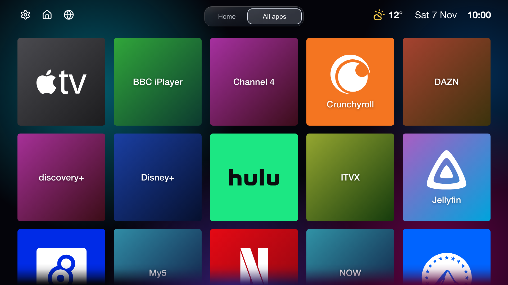
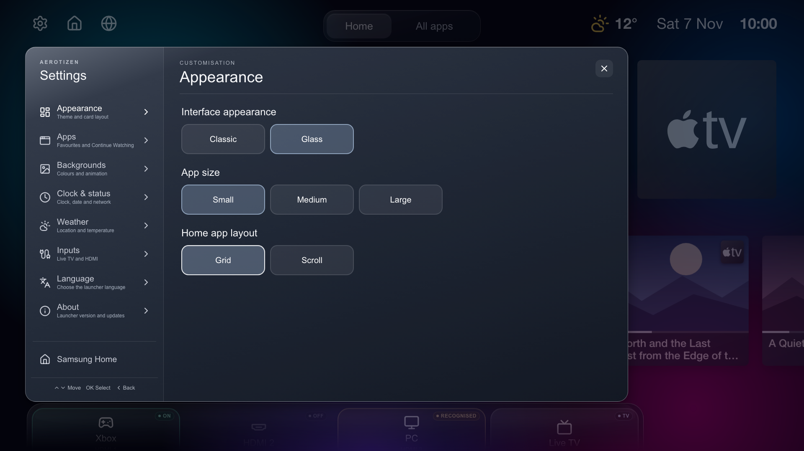

# Use the launcher

These controls are for launcher 2.7.0.

Use **Home** for favourites and **All apps** for the installed apps. Hold **OK**
on a tile to move it or add it to or remove it from Home. AeroTizen uses artwork
from the TV. If artwork is unavailable, the tile shows the app icon and name.

| All apps | Settings |
| --- | --- |
|  |  |

These browser previews use sample data.

## Personalise Home

- **Appearance.** Choose **Small**, **Medium**, or **Large** under **App size**.
  Choose **Grid** or **Scroll** under **Home app layout**.
- **Backgrounds.** Choose a solid colour, gradient, or animated background. Select
  **Custom** under **Solid colour** or **Gradients** to make your own. Adjust the
  speed of animated backgrounds and preview them. Optional
  [dynamic weather wallpapers](dynamic-weather-wallpapers.md) use nine bundled scenes. See their
  [credits and redistribution terms](../launcher/assets/weather/CREDITS.md).
- **Weather.** Search for your town or postcode, or use the approximate location.
  Choose the temperature units and whether to show weather or the place name.
  Hiding weather stops location and forecast requests when dynamic weather
  wallpapers are off.
- **Clock & status.** Choose **No time** or **No date** to hide either item.
  Use **Network indicator visibility** to show or hide Ethernet or Wi-Fi status.
- **Inputs.** Rename HDMI inputs and choose whether to show disconnected ports
  or Live TV.
- **Language.** Choose the language for AeroTizen.

You can open the Samsung app store or switch to Samsung Home from Settings.
The app list can include HbbTV apps such as BBC iPlayer and an optional Fireplace tile.
See [Home button and startup](home-pc-flow.md) for remote button and Art Mode behaviour.

## Continue Watching

Open **Settings → Apps → Continue Watching**. Select **On**, then select apps.
A combined row appears below your Home apps when the selected apps provide records.
The setting starts off. Switching it off hides the row and stops feed reads. Your
app selections stay saved.

The launcher finds apps that declare a Samsung Continue Watching feed. It can read
these feeds on the TV without opening the apps or using root. Empty feeds add no
cards. The launcher disables choices whose app IDs it cannot match.

The row refreshes on startup, on return to AeroTizen, and when you change app
selections. Empty feeds get two short retries during a normal refresh and up to
five minutes of retries at startup. The retries stop when data arrives, when you
leave AeroTizen, or when you switch the feature off. Viewing records stay in memory.

Each app provides the activity times and launch data for its cards. Old records and
approximate times can appear. Records with unknown times sort last, and different
episodes stay separate. Cards show artwork, the source app, and programme progress
when available. Opening the correct programme still needs confirmation per app.

### Stremio

Stremio requires launcher 2.7.0 and the root helper from CLI 3.0.0, or development
builds with both changes. Set up or upgrade the helper using the [root guide](root-cli.md),
then select **Stremio** in Continue Watching.
